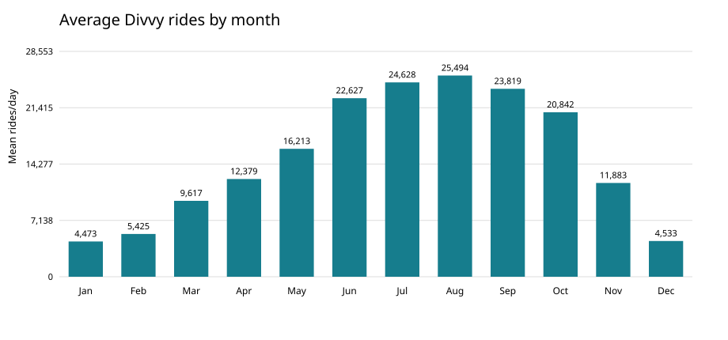
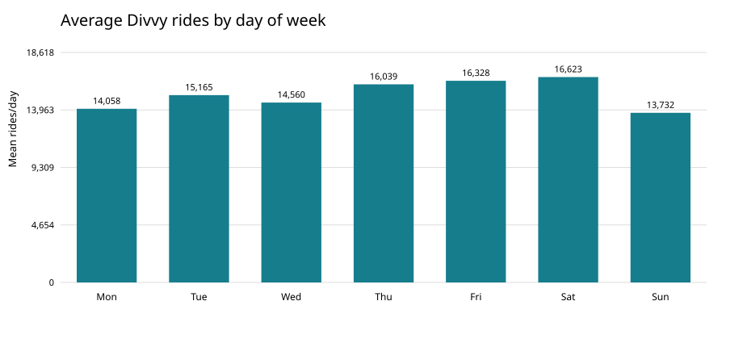
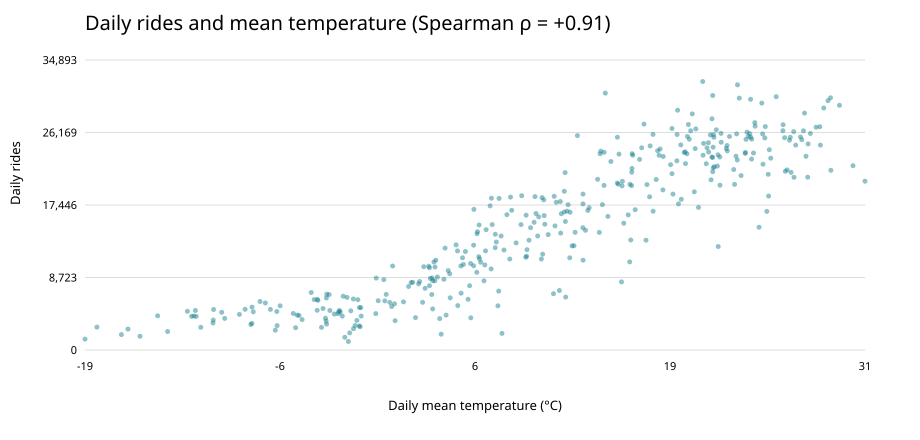
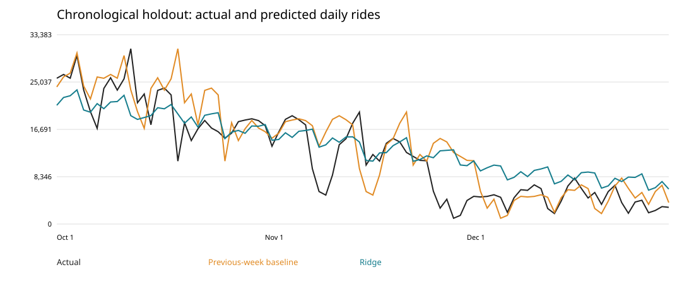

## Exploratory findings and chronological evaluation
### Exploratory findings
- The 2025 table contains 365 daily observations. Ridership averaged **15,213 rides/day** (median 15,360; standard deviation 8,552). The lowest day was **Nov 29** (1,024) and the highest was **Aug 2** (32,308)

- Monthly average rides show a pronounced warm-season peak and winter trough:
  
| Month | Mean rides/day |
|---|---:|
| Jan | 4,473 |
| Feb | 5,425 |
| Mar | 9,617 |
| Apr | 12,379 |
| May | 16,213 |
| Jun | 22,627 |
| Jul | 24,628 |
| Aug | 25,494 |
| Sep | 23,819 |
| Oct | 20,842 |
| Nov | 11,883 |
| Dec | 4,533 |

- The mean on weekend days was **15,178 rides**, versus **15,228** on weekdays (-0.3%). Day-of-week averages are:

| Day | Mean rides/day |
|---|---:|
| Mon | 14,058 |
| Tue | 15,165 |
| Wed | 14,560 |
| Thu | 16,039 |
| Fri | 16,328 |
| Sat | 16,623 |
| Sun | 13,732 |

- Spearman rank correlations with daily rides were +0.91 for temperature, +0.04 for rain, and -0.49 for snowfall. These are descriptive associations, not causal effects. Because temperature and ridership both change over the year, the temperature association may largely reflect season. The weather file's fixed UTC offset still needs DST/source verification; weather findings are provisional. One year contains only one winter and one summer, so it cannot distinguish a repeatable seasonal cycle from 2025-specific conditions.

### Chronological evaluation
- The October 1–December 31, 2025 holdout covers 92 days. The Ridge model is fit once using eligible January–September dates. At the start of each seven-day block, both forecasts use actual rides from the previous week, which are already available. The final block contains only December 31
- The baseline repeats the count from seven days earlier. The Ridge model in [forecasting.ipynb](../forecasting.ipynb) uses that same count along with weekday indicators and annual sine and cosine terms. The model standardizes the predictors using the training period and uses a Ridge penalty of 10. Both forecasts use calendar dates and past ride counts only

| Model | MAE (rides) | RMSE (rides) | Bias (predicted − actual) | WAPE |
|---|---:|---:|---:|---:|
| Previous-week baseline | 3,436 | 4,995 | +1,726 | 27.7% |
| Team Ridge model | 3,511 | 4,400 | +1,525 | 28.3% |

- The team Ridge model’s MAE is 2.2% higher than the baseline. Its RMSE is 11.9% lower. MAE measures the average size of a daily miss. RMSE gives more weight to large misses. Both forecasts overpredicted on average in this holdout, so taking their daily estimates at face value could lead to staging more bikes than needed. WAPE is total absolute error divided by total actual rides

### Limitations and next steps
- The forecast is citywide and daily; it does not determine station-level bike placement.
- The evaluation covers one late-year period in one calendar year. Metrics may not generalize to another year.
- The operational evaluation intentionally excludes weather predictors. Add weather only after verifying local-date/DST alignment and using weather forecasts archived or available at each issue date.
- The previous-week baseline and Ridge model are compared on identical dates. Inspect horizon-specific error in `chronological_metrics_by_horizon.csv` and error direction before making staging recommendations.
